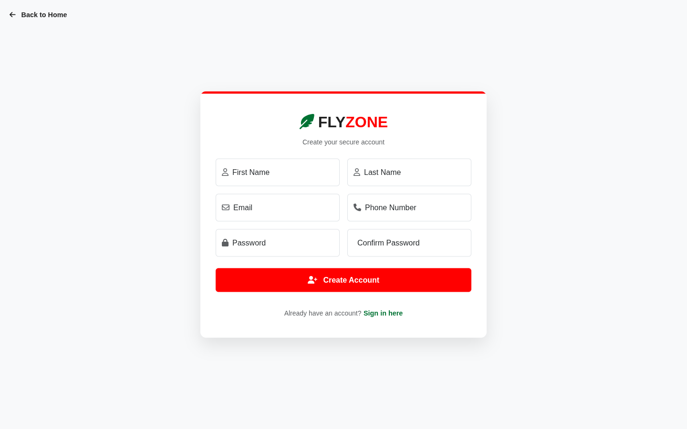
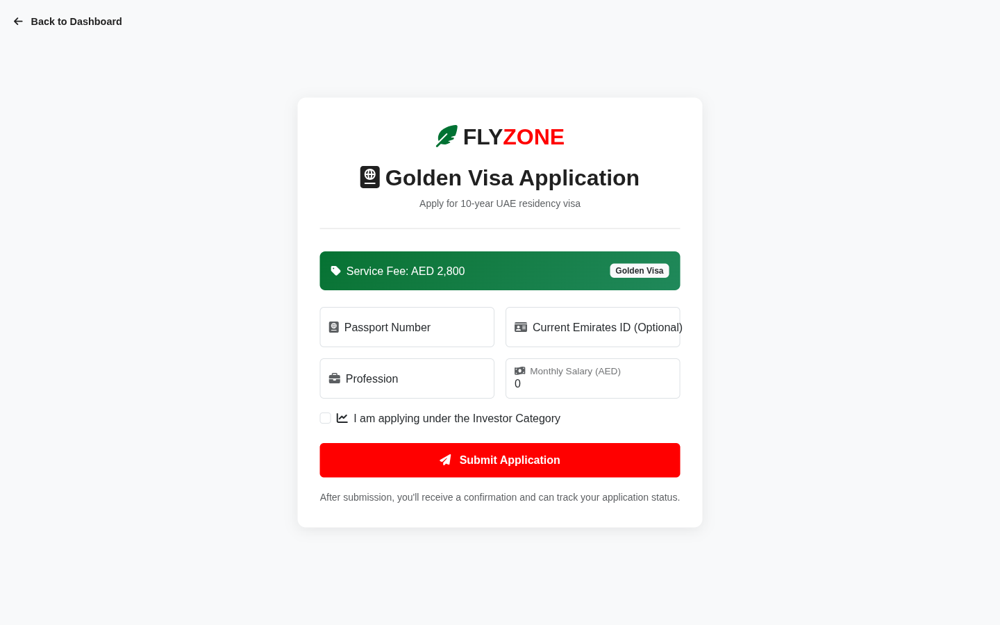
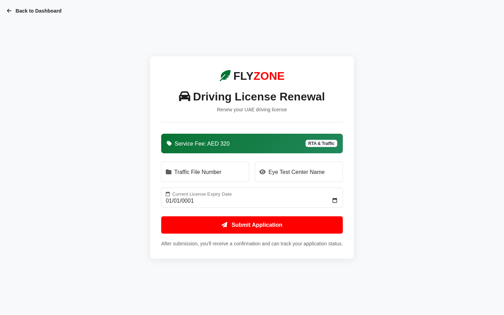
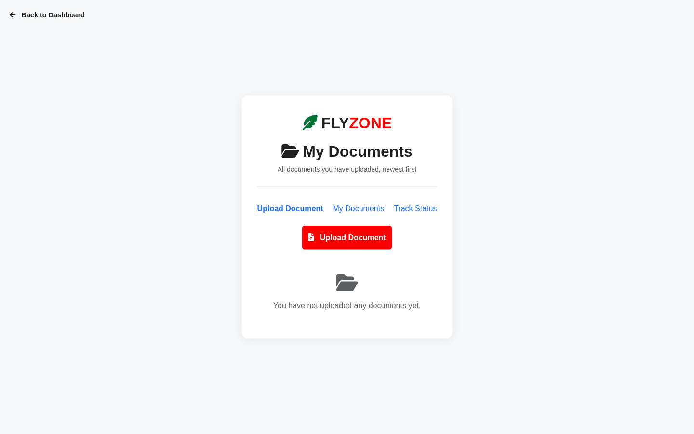
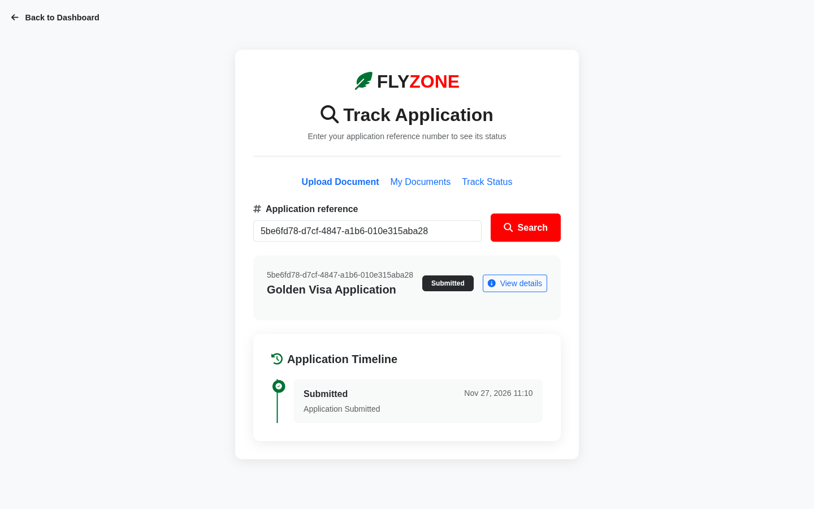

# 🦅 Flyzone Tourism & Typing Services

[](https://github.com/ibraramin/FlyzoneMockup/actions/workflows/ci.yml)

An ASP.NET Core 10 MVC application for UAE tourism/typing services: registration, two service application forms, a personal dashboard, a secure document-upload endpoint, and a role-gated admin review queue.

> **Scope note:** this is a portfolio/demo application derived from an older client mockup, not a production service. Some UI affordances are still placeholders; they are listed under [Known limitations](#-known-limitations). Claims below are kept deliberately narrow so they can be checked by running the commands in this README.


---

## ✨ What works today

### 🔐 Authentication & security
- ASP.NET Core Identity with strict password policy (min 8, upper/lower/digit/symbol, 4 unique characters).
- Account lockout after 5 failed attempts for 15 minutes — enforced by `lockoutOnFailure: true`.
- Fixed-window rate limits: 10/min on auth actions, 5/min on form submissions and uploads (global per window, not partitioned per IP).
- Antiforgery tokens on MVC POST forms; the upload action validates the request token.
- Security headers on all responses (X-Frame-Options, nosniff, Referrer-Policy, CSP). CSP forbids inline/eval scripts; the remaining CDN script sources are Bootstrap (jsDelivr) and Font Awesome (cdnjs). The hero region graphic is self-contained — no map-tile provider or API key is required.
- Document-upload endpoint with extension allow-list, magic-byte and declared-MIME checks, GUID filenames, ownership checks on `applicationId`, and an allow-list for `documentType`.

### 📝 Service applications
- **Golden Visa application** and **Driving License renewal** forms with server-side validation. Forms resolve their `ServiceId` from the `TypingServices` catalog by name rather than hard-coded integers.
- Status (`Submitted → UnderReview → ActionRequired / WaitingPayment → Completed / Rejected`) and an `ApplicationHistory` record written on submission.

### 🗂️ Applicant workflow
- Upload UI posting to the tested endpoint, an owner-scoped "My Documents" list, and an auth-gated download action (files live outside `wwwroot`).
- Application details and a status-history timeline, linked from dashboard recent-activity rows; a Track page looks up an application by its reference.

### 🛡️ Admin review queue
- ASP.NET Core Identity roles with an `Admin` role requirement: a review queue with status/date filtering, application details, and a transactional status transition that appends an `ApplicationHistory` row and edits internal notes.
- The applicant dashboard shows an "Admin Queue" link only to users in the `Admin` role. Non-admins are redirected to the access-denied path.

### 📊 Dashboard
- Personalized welcome, application counts, an active-application progress card, and a recent-activity list.

### 🧾 Service catalog
- The landing page renders active `TypingService` rows from SQLite (category, name, description, base fee); inactive rows are filtered out. The catalog is seeded through EF Core migrations.

### 🐳 Containers
- Multi-stage Dockerfile and a Compose file with SQLite and upload volumes.
- Container listens on **8080**; Compose publishes it on host **5000**. Healthcheck probes HTTP with `curl`.

---

## 🛠️ Technology stack

| Layer | Technology |
|---|---|
| Framework | ASP.NET Core 10.0 MVC |
| Database | SQLite with EF Core 10 (Code First migrations) |
| Authentication | ASP.NET Core Identity |
| Frontend | Razor views, Bootstrap 5, Font Awesome 6.4 (CDN) |
| Testing | xUnit + `Microsoft.AspNetCore.Mvc.Testing` |
| Containers | Docker and Docker Compose |

---

## 🚀 Getting started

### Prerequisites
- [.NET 10 SDK](https://dotnet.microsoft.com/download/dotnet/10.0)
- Docker (optional, for containers)

### Local development

```bash
git clone https://github.com/ibraramin/FlyzoneMockup.git
cd FlyzoneMockup
dotnet restore
dotnet build --no-restore
dotnet run
```

Open **http://localhost:5112** (HTTP launch profile). The HTTPS profile is `https://localhost:7035`.

The SQLite database `flyzone.db` is created/migrated on first start and seeded with six active catalog services (Golden Visa, Driving License, Emirates ID, Work Permit, Business License, Document Attestation). Register a new account through `/Account/Register` to use the authenticated pages.

**Demo accounts** (local `dotnet run` and the Compose container enable `DemoData:Enabled=true`; real deployments leave it off):

| Role | Email | Password | What you can see |
|---|---|---|---|
| Applicant | `demo@flyzone.example` | `Demo@1234` | Three sample applications with status history, documents and Track results |
| Admin | `admin@flyzone.example` | `Admin@1234` | `/Admin` review queue; change a status and watch the applicant timeline update |

These accounts are public demo fixtures only — change or disable `DemoData` before exposing the app to untrusted users.

### Tests

```bash
dotnet test
```

Integration tests use an isolated temporary SQLite database via `WebApplicationFactory`, so they do not touch your local `flyzone.db`. The workflow in `.github/workflows/ci.yml` runs restore (NuGet advisories as errors), a warnings-as-errors Release build, and the test suite on every push/PR.

### Docker

```bash
docker compose up --build
```

Compose maps host port **5000** to container port **8080**; open **http://localhost:5000** once the container reports healthy. The container writes the SQLite DB, Data Protection keys and uploaded documents to the `App_Data` bind mount; uploads are stored outside `wwwroot` and served only through the owner-gated download action.

---

## 📁 Project structure

```
FlyzoneMockup/
├── Controllers/          # AccountController, HomeController, ServicesController
├── Data/                 # EF Core DbContext + migrations
├── Models/               # Entities and form models
├── ViewModels/           # MVC view models
├── Views/                # Razor views
├── tests/                # xUnit integration tests
├── docs/                 # Gameplan, research, ADRs and resume evidence
├── wwwroot/              # Static assets
├── App_Data/             # Runtime data: SQLite DB, Data Protection keys, uploads (not under wwwroot)
├── imgs/                 # Screenshots
├── Dockerfile
├── docker-compose.yml
└── Program.cs
```

---

## 🔒 Security configuration

- Password policy: 8+ characters, uppercase, lowercase, digit, non-alphanumeric, 4 unique characters.
- Lockout: 5 failed attempts → 15 minutes.
- Rate limits: auth 10/min per window; form submissions 5/min per window (global fixed-window, not partitioned per IP).
- Uploads: `.pdf`, `.jpg`, `.jpeg`, `.png`; max 5 MB; magic-byte + declared MIME validation; GUID filenames; documents can only be attached to applications owned by the signed-in user.
- Dependency audit: `dotnet list package --vulnerable --include-transitive` should report no vulnerabilities (the transitive SQLite native package is pinned to a patched version).
- Auth cookie: HttpOnly + SameSite=Lax, `Secure` forced outside Development, 14-day sliding expiry.
- Data Protection keys default to the user's local application data; in the container `DataProtection:KeysPath` points at `/app/Data/keys` on the mounted volume, so antiforgery tokens survive restarts. Integration tests use a throwaway key directory.
- Database migrations fail fast in Production instead of serving a broken schema.

---

## 📸 Screenshots

| Login | Registration | Dashboard |
|---|---|---|
|  |  |  |

| Golden Visa form | Driving License form |
|---|---|
|  |  |

| Upload | My Documents | Track Status |
|---|---|---|
|  |  |  |

| Application details + timeline | Admin review queue | Admin status transition |
|---|---|---|
|  |  |  |

All screenshots were recaptured from a clean local database on 2026-11-27 after registration and a real Golden Visa submission. Each resume bullet is paired with a command that was actually run in [`docs/RESUME-EVIDENCE.md`](docs/RESUME-EVIDENCE.md).

---

## 🚧 Known limitations

- The document-upload UI posts to the tested upload endpoint; document download is auth-gated so only the owner can retrieve a file.
- Status history is rendered as a timeline on the Details and Track pages, and an admin can now append transitions through the review queue. There is no workflow engine, approval chain or notification on transition.
- Document management beyond upload/list/download (editing, sharing, versioning) is not implemented. Appointments and password reset remain out of scope.
- Notifications, localization, and search/filter are not implemented.
- The hero shows a stylized, self-contained region graphic rather than a live map; it requires no tile provider or API key.
- CSP allows third-party CDN scripts required by the current UI; inline and eval scripts are forbidden. Self-hosting those assets is a future improvement.
- Container startup was smoke-tested from clean volumes: `curl -f http://localhost:5000/` returns 200 and the seeded catalog is present. Landing-page filler cards and dead "Instant Scheduling" copy were removed; the remaining static labels are honest placeholders.
- SQLite is used deliberately for a self-contained demo; it is not a multi-user production datastore.

See [`docs/GAMEPLAN.md`](docs/GAMEPLAN.md) for the finishing plan, [`docs/RESEARCH.md`](docs/RESEARCH.md) for the feature research, [`docs/adr/`](docs/adr/) for scope decisions, and [`docs/RESUME-EVIDENCE.md`](docs/RESUME-EVIDENCE.md) for verifiable resume bullets.

---

## 🤝 Contributing

Contributions are welcome. Please open an issue before large changes; keep `dotnet test -c Release --no-build` green.

---

## 📄 License

Released under the [MIT License](LICENSE). Earlier drafts said "no license granted"; that notice was superseded when the owner approved publication.

---

## 📧 Contact

For questions about this portfolio project, contact the repository owner.
