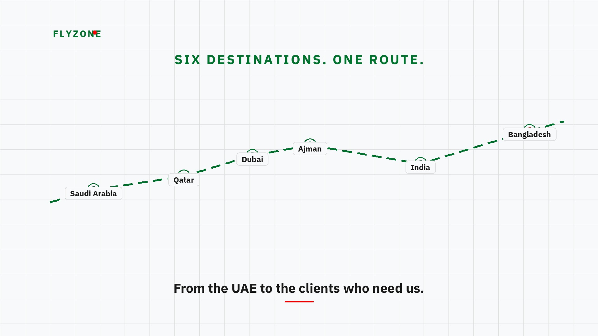
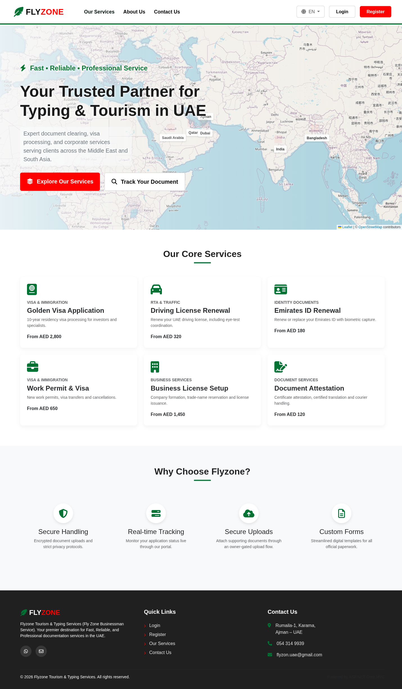
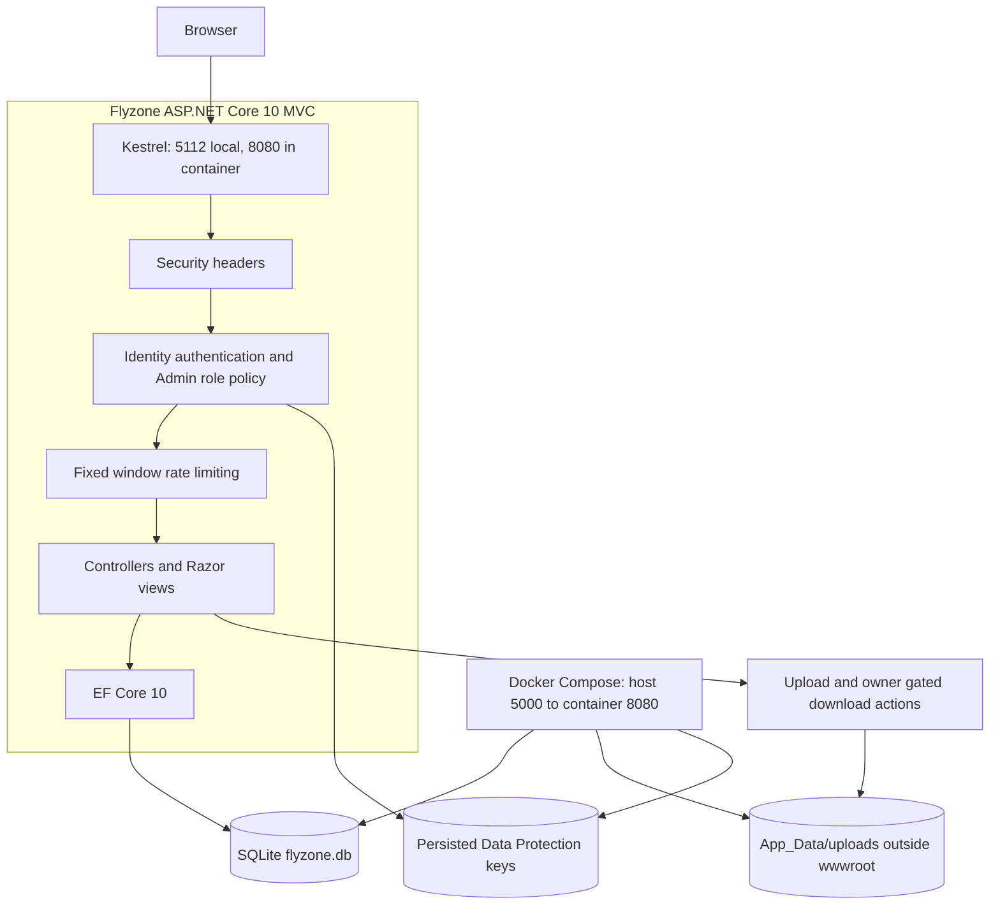
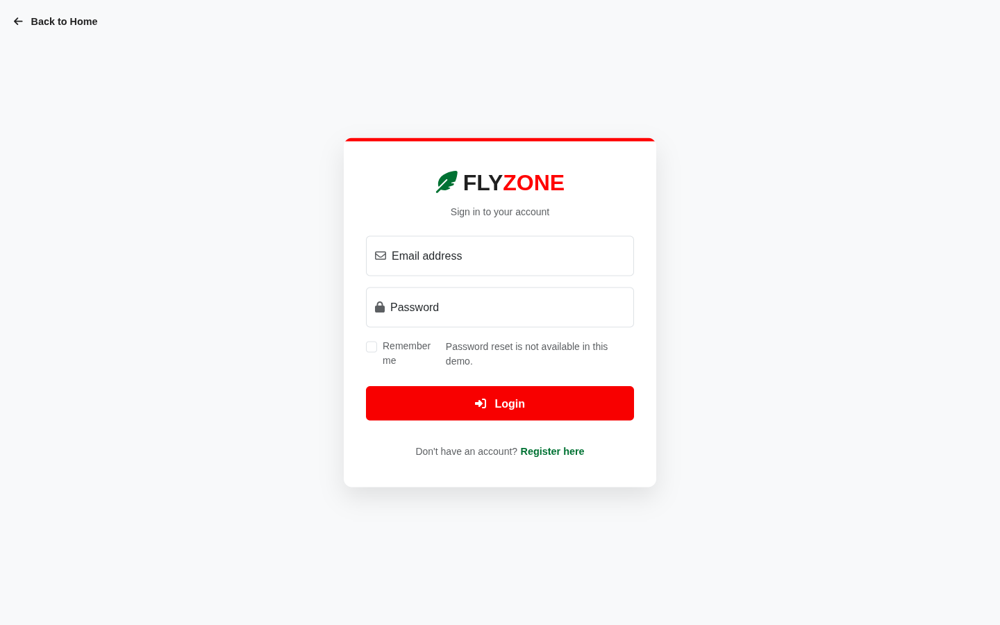
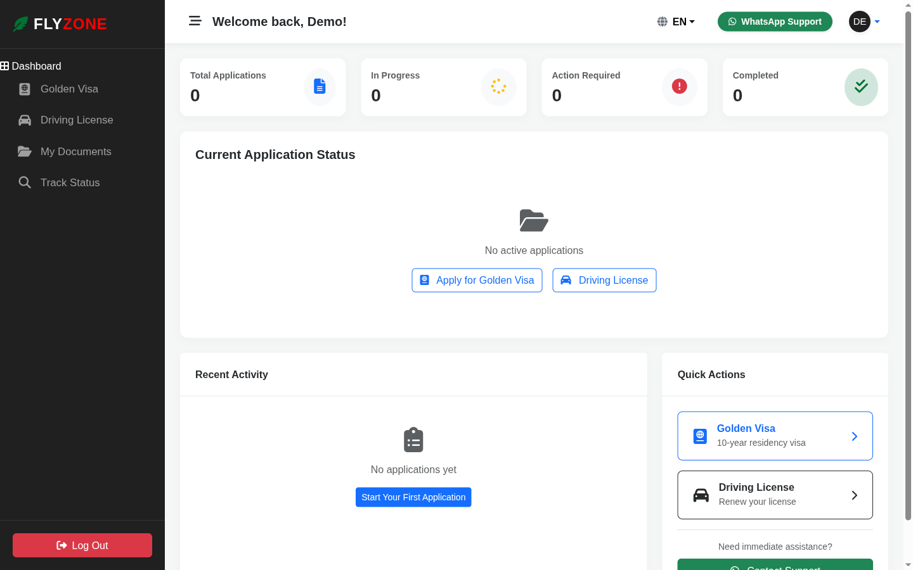
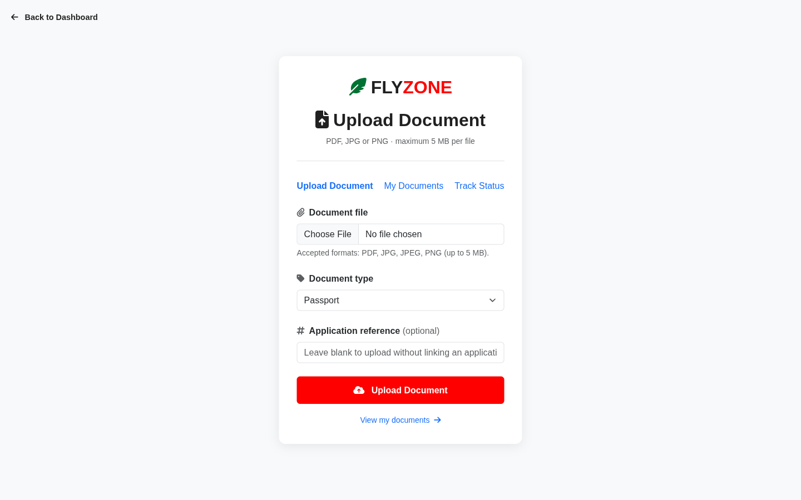
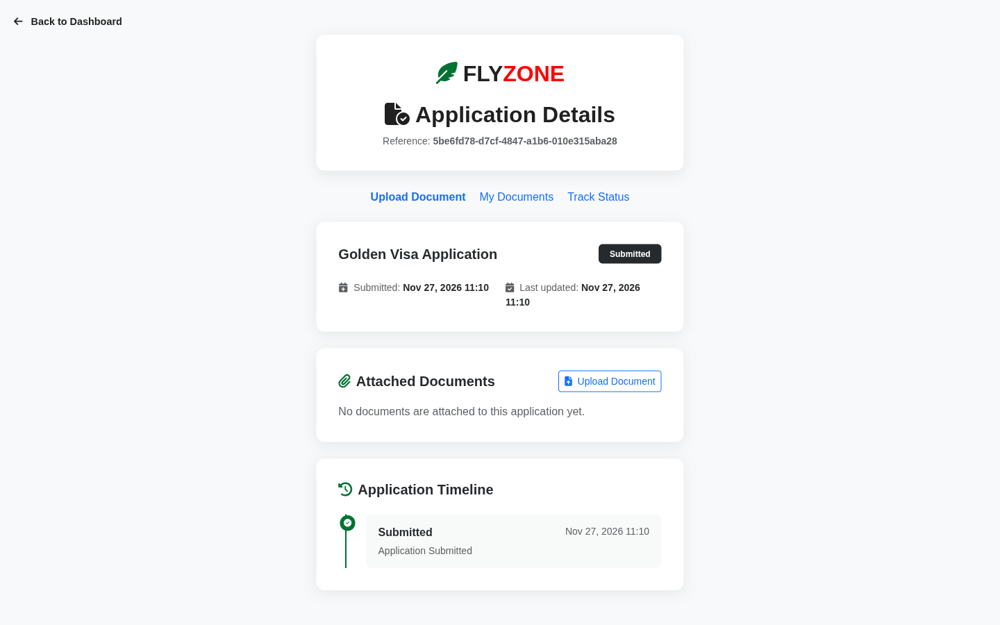
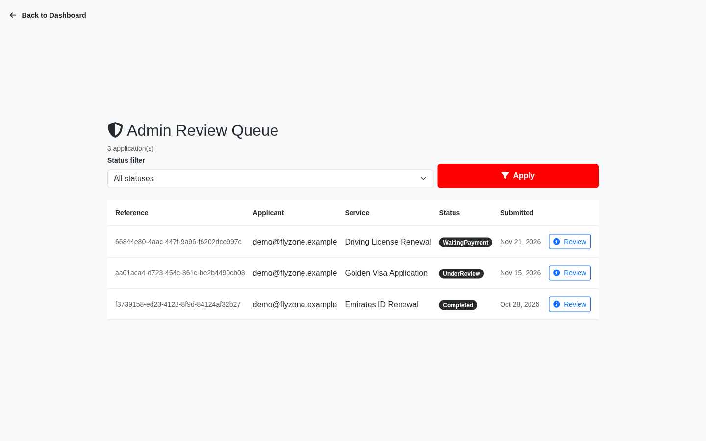
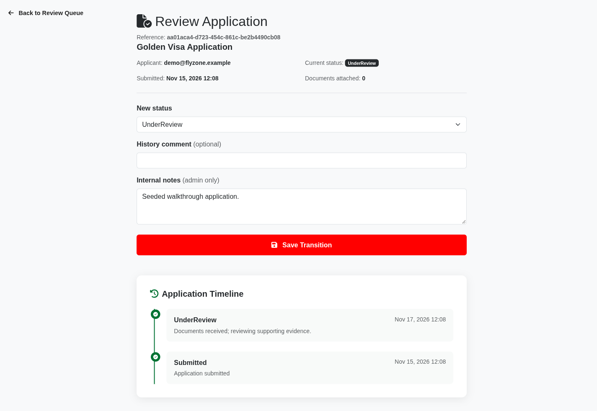

# Flyzone

[](https://github.com/ibraramin/Flyzone/actions/workflows/ci.yml)
[](LICENSE)

**Flyzone is a self-contained ASP.NET Core 10 MVC application for UAE tourism and typing services.** It walks through a service catalog, two application forms, document uploads, status tracking, and a role-gated admin review queue.

[](docs/assets/brag.mp4)

https://github.com/user-attachments/assets/05985747-ab38-4344-838a-f82d39ff2626



It is built for .NET developers, hiring teams, and anyone who wants a server-rendered MVC reference app with practical security controls that can be started with one command.


---

## Key features

- **ASP.NET Core MVC:** Server-rendered Razor views on .NET 10, EF Core 10 with SQLite, Code First migrations that run at startup, dependency injection throughout, and an xUnit integration-test suite using `WebApplicationFactory`.
- **Identity with a strict password and lockout policy:** ASP.NET Core Identity local accounts require unique emails and passwords of at least 8 characters with upper case, lower case, a digit, a symbol, and 4 unique characters. Five failed sign-ins lock an account for 15 minutes. The auth cookie is HttpOnly, SameSite=Lax, and forced to Secure outside Development, with a 14-day sliding expiry.
- **Rate limiting:** Fixed-window policies allow 10 requests per minute on account actions and 5 per minute on form submissions and uploads. Rejections return HTTP 429. The limits are global per window rather than partitioned per client IP.
- **Secure uploads:** PDF, JPEG, and PNG only, capped at 5 MB, checked against both file signatures and declared MIME types, saved under generated GUID names, and stored outside `wwwroot`. Documents can only be attached to applications owned by the signed-in user, and downloads are restricted to that owner.
- **Security headers:** Every response carries `X-Frame-Options: DENY`, `X-Content-Type-Options: nosniff`, a strict referrer policy, and a Content Security Policy that forbids inline and eval scripts. The policy permits the Bootstrap and Font Awesome CDN origins used by the views. Data Protection keys are persisted so antiforgery tokens survive container restarts.
- **Tourism and typing workflows:** Six seeded services are read from the database by the landing page. Golden Visa applications and Driving License renewals use server-side validation and resolve their service from the catalog by name. Applicants get a dashboard, status history timelines, Track by reference, and My Documents. Administrators sign in to a review queue with filtering, transactional status changes, status-history entries, and internal notes.

---

## Quickstart

### Prerequisites

- [.NET 10 SDK](https://dotnet.microsoft.com/download/dotnet/10.0)
- Docker with Compose, only for the container path below

### Run locally

```bash
git clone https://github.com/ibraramin/Flyzone.git
cd Flyzone
dotnet restore
dotnet build --no-restore
dotnet test
dotnet run
```

Open **http://localhost:5112** for the HTTP launch profile, or **https://localhost:7035** for HTTPS. The SQLite file `flyzone.db` is created and migrated on first start.

Optional dependency audit:

```bash
dotnet list package --vulnerable --include-transitive
```

### Demo accounts

Local Development configuration and the Compose container set `DemoData:Enabled=true`. The default configuration leaves it off. These credentials are public walkthrough fixtures, so disable demo data before exposing the app.

| Role | Email | Password | What you can see |
|---|---|---|---|
| Applicant | `demo@flyzone.example` | `Demo@1234` | Three sample applications with status history and Track results |
| Admin | `admin@flyzone.example` | `Admin@1234` | The `/Admin` review queue, where a status change updates the applicant timeline |

### Run with Docker Compose

```bash
docker compose up --build
curl -f http://localhost:5000/
docker compose down
```

Compose publishes container port **8080** on host port **5000** and reports health with an HTTP probe. The SQLite database, Data Protection keys, and uploads persist in the `./App_Data` bind mount. The CI workflow in `.github/workflows/ci.yml` runs an audit-enabled restore, a warnings-as-errors Release build, and the tests on pushes and pull requests to `main`.

---

## Architecture



---

## Screenshots


| Landing page | Login | Registration |
|---|---|---|
|  |  |  |

| Dashboard | Golden Visa form | Driving License form |
|---|---|---|
|  |  |  |

| Upload | My Documents | Track status |
|---|---|---|
|  |  |  |

| Application details | Admin queue | Admin review |
|---|---|---|
|  |  |  |

---

## Scope

- Flyzone is a single-instance application backed by SQLite. It is designed for evaluation and demonstrations, not multi-tenant production hosting.
- Accounts are local Identity accounts. Email confirmation, password recovery, and external sign-in providers are not part of this application.
- Status changes are explicit admin actions recorded in `ApplicationHistory`. Payments, appointments, and notifications are not part of this application.
- Document handling covers upload, owner-scoped listing, and owner-gated download. Editing, sharing, and versioning are not part of this application.
- The catalog is seeded through EF Core migrations. The hero uses a locally vendored Leaflet 1.9.4 map with keyless OpenStreetMap tiles and no API key; the tiles need network access.
- Bootstrap 5.3 and Font Awesome 6.4 load from public CDNs on most pages, with local bundles also available under `wwwroot/lib`.

---

## Project structure

```
Flyzone/
├── Controllers/    Account, Home, Services, and Admin controllers
├── Data/           EF Core DbContext and the opt-in demo seeder
├── Migrations/     Code First migrations, including the catalog seed
├── Models/         Entities, forms, and status values
├── ViewModels/     MVC view models
├── Views/          Razor views
├── tests/          xUnit integration tests
├── docs/           Research, ADRs, and project notes
├── wwwroot/        Static assets
├── imgs/           Screenshots shown above
├── Dockerfile
├── docker-compose.yml
└── Program.cs
```

---

## Contributing

Issues and pull requests are welcome. Run `dotnet test -c Release --no-build` before opening a pull request.

---

## License

Released under the [MIT License](LICENSE).

---

## Links

- Repository: https://github.com/ibraramin/Flyzone
- Issues: https://github.com/ibraramin/Flyzone/issues
- CI workflow: https://github.com/ibraramin/Flyzone/actions/workflows/ci.yml
- Design notes and decision records: [docs/](docs/), [docs/adr/](docs/adr/)
